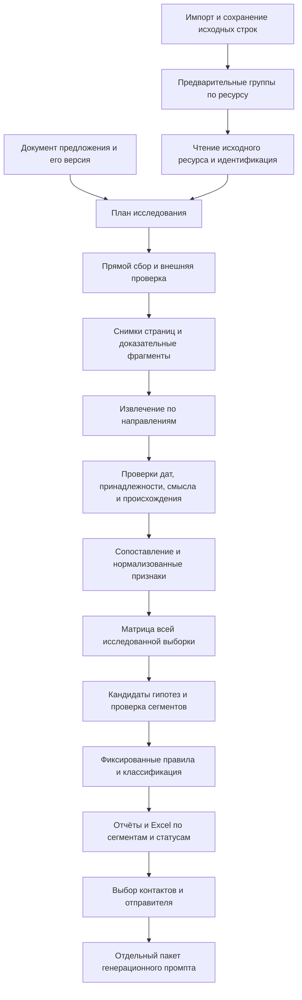

# Архитектурное ревью и целевая архитектура v3

Дата: 9 октября 2026. Статус: проект по результатам трёх специализированных ревью, без изменения рабочего конвейера.

## Задача и полномочия

Сначала исправить архитектурные процессы. Затем подключить аккаунт ChatGPT Plus и провести контрольные испытания. Тесты логики на фикстурах нужны в ходе разработки; реальные модельные вызовы и возобновление массового исследования в эту фазу не входят. Наблюдение остаётся выключенным.

Выбран путь постепенной доработки существующего приложения: модульный монолит с устойчивыми заданиями, версионированными результатами и общими проверками доказательств. Переписывать интерфейс, вводить микросервисы, брокер сообщений или менять SQLite заранее не требуется.

## Состав специалистов

| Направление | Ответственность | Результат и проверка |
|---|---|---|
| Архитектор исследовательской методики и инженер качества LLM | Исходные правила, идентичность, доказательства, сопоставление, сегменты | Контракты evidence/signal/hypothesis; контроль ошибок дат, смысла, независимости |
| Инженер сбора данных и надёжности обработки | Обход ресурсов, план поиска, очередь, сохранение, повторные попытки, расходы | Схема исполнения и восстановления; тесты отказов и конкурентности |
| Продуктовый архитектор и QA данных | Исходная идея, импорт, отчёты, выбор контактов, промпты и Excel | Пользовательский путь, границы API, сохранность строк и версии результатов |
| Ведущий архитектор | Сведение трёх ревью, разрешение противоречий, порядок внедрения | Этот документ, зависимости этапов и критерии готовности |

Три специализированных агента выполнили независимые read-only ревью. Ведущий агент сопоставил выводы. Роли описывают компетенции и ответственность, а не наличие внешней человеческой команды.

## Источники требований и приоритет

1. Последние решения пользователя в беседе.
2. Исходные «Правила сегментации» и «Политика глубины исследования…», доступные в текстовых вложениях.
3. development_spec_source.md как историческая спецификация и документы аудита.
4. Реализация и тесты как свидетельство текущего поведения, а не обязательное требование.

Исходные DOCX по прежним путям сейчас отсутствуют. Их содержание заново не проверено; это ограничение ревью. Доступные текстовые правила прочитаны непосредственно.

Этот документ уточняет устаревшие положения development_spec_source.md: отправитель не нужен до исследования; создание промпта — отдельное действие после выбора аудитории; денежный hard cap снят; социальные сети и форумы — 30 дней; модели подбираются заранее, без лишних настроек при запуске. Не восстанавливать отменённые требования из старого документа.

## Сохраняемый пользовательский процесс

Название базы + описание фильтров выгрузки + исходный Excel + описание/документ предложения → автоматическое исследование → отчёты и сегменты/гипотезы → выбор сегмента и контактов → данные отправителя → документ с генерационным промптом и выбранный Excel.

Фильтры выгрузки описывают происхождение базы, но не доказывают свойства каждой компании. Юрлицо/подпись отправителя нужны при создании промпта. Описание услуг необходимо раньше, чтобы исследование искало релевантные обстоятельства. Контракт внешнего генератора и рассылка не входят в приложение.

Отдельные Excel по статусам сохраняются без outbound-промпта. Не распределять компании принудительно. Пользователь видит краткий результат, основание гипотезы, ограничения и раскрываемые промежуточные отчёты.

## Карта проблем

| Приоритет | Подтверждение в текущем коде | Изменение |
|---|---|---|
| P0 | pipeline.py: research запускает discovery до чтения исходного сайта | Сначала исходный ресурс и ссылки, затем план внешней проверки |
| P0 | verify_report принимает неподтверждённые даты; синтетический social-пример сохранил HIGH | Основание даты, тип даты, правила актуальности в коде |
| P0 | rules.py приближает независимость разными доменами | Первичный источник, издатель, семейство перепечаток и различные сигналы |
| P0 | synthesis связывает признаки по пересечению evidence_ids | Проверка смысла, субъекта и полярности; сохранение исходных signal IDs |
| P0 | api.py retry очищает research/profile компании | Новая ревизия и повтор только необходимых зависимостей |
| P0 | llm.py перезаписывает повторно используемую запись ModelCall после reconciliation | Неизменяемые попытки и отдельный кэш результатов |
| P1 | workflow.py upload_context делает черновик из первых ~2500 символов; запуск берёт summary | Полный неизменяемый документ и проверяемое извлечение офферов/границ |
| P1 | segment использует свободные имена признаков и массивы профилей | Реестр признаков, матрица всей выборки, проверка кандидатов до LLM-review |
| P1 | payload содержит текущую дату; checkpoint чанка не выделен | Фиксированная дата ревизии и сохранение каждого результата |
| P1 | Последовательный цикл компаний | Ограниченная очередь после защиты записей и повторов |
| P1 | Ресурс используется для группировки до подтверждения идентичности | Предварительная группа, явные основания подтверждения/конфликта |

Риски конкурентных записей сейчас перспективные: они возникнут при наивном добавлении потоков. SQLite уже использует WAL, а агрегаты расходов увеличиваются атомарно; это не нужно «исправлять» как существующую потерю обновлений.

## Целевой конвейер

Не каждый прямоугольник требует отдельной модели или отдельного сервиса. Загрузка, нормализация, проверка ссылок, даты, сохранение, логические правила и экспорт выполняются кодом. Модель нужна для извлечения смысла, неоднозначного сопоставления и гипотез; результат проверяется независимо от провайдера.

## Границы модулей

- ImportService сохраняет исходный файл, позиции ячеек, типы, дубликаты и связь строк с предварительными сущностями.
- ContextService хранит полный документ предложения, его хеш и версию. Краткое описание не заменяет невидимый остаток документа. Услуги, границы и разрешённые утверждения привязаны к фрагментам документа; извлечение разделяется на части без молчаливого усечения.
- AcquisitionService читает ресурсы, извлекает ссылки до удаления навигации/подвала, кэширует robots и страницы, применяет ограничения домена и сохраняет происхождение.
- ResearchPlanner поддерживает матрицу пяти направлений и список конкретных открытых вопросов. Discovery возвращает кандидатов, а не доказательства прочитанной страницы.
- EvidenceValidator проверяет фрагменты и даты; semantic validation проверяет, подтверждает ли текст именно заявленный факт. Не обещать, что проверка подстроки доказывает смысл.
- ProfileService сопоставляет отчёты через стабильные идентификаторы признаков, не придумывая новые факты.
- SegmentationService строит общую матрицу, предлагает кандидатов, проверяет правила и классифицирует всех по одной версии.
- JobCoordinator выдаёт ограниченное число company jobs и обеспечивает барьер перед сегментацией.
- ModelGateway отделяет возможности провайдера, исполнение, кэш и учёт. API/локальная модель/будущая подписка реализуют адаптеры одного внутреннего контракта; неподдерживаемые параметры нельзя просто пересылать.
- Presentation/Export/PromptPackage сохраняют существующий отдельный пользовательский процесс, используя версии результатов.

## Минимальные контракты хранения

Добавлять таблицы/типизированные артефакты постепенно, а не переносить сразу все JSON.

| Сущность | Обязательные данные |
|---|---|
| ResearchRevision | run_id, revision, research_as_of, source/context hashes, policy/prompt/parser/model versions |
| CompanyJob | company_id, revision, state, stage, owner, lease_until, attempt, checkpoint |
| SourceSnapshot | URL и конечный URL, fetched_at, content hash, текст/путь, принадлежность, доступность, причина ошибки |
| Evidence | snapshot_id, fragment_id/offset, субъект, scope, факт, date value/type/evidence, publisher/original source/duplicate cluster |
| Observation | неизменяемое predicate/value/polarity, evidence_ids, fact/interpretation, основание уверенности |
| Signal | canonical_id, исходные наблюдения, evidence_ids, polarity, confidence, validation version, причины неопределённости |
| DirectionResult | revision, источники, вопросы/поиски, coverage, termination_reason, evidence/signals/limitations |
| ProfileRevision | direction revisions, нормализованные признаки, конфликты, достаточность |
| SegmentSet | revision, dataset/profile revisions, определения и формальные правила, протокол проверки |
| Classification | profile/segment versions, matched signals/evidence, primary либо причина отказа |
| ModelOperation / Attempt | стабильный operation key; отдельные attempt IDs, состояние, response_id, raw usage, cost estimate, reservation, tariff version |

Отсутствие публикационной даты хранить как null. Дата получения — отдельное поле. Неизвестное происхождение не означает независимость. Два разных сигнала не заменяются двумя URL одного факта. Отсутствие информации не означает опровержение.

## Сбор и достаточность: важное ограничение экономии

Исходная политика требует внешнего поиска в базовом проходе. Прямое чтение сайта уменьшает слепой поиск, но не даёт права отмечать все внешние направления проверенными. Сохраняем полную методику по умолчанию. Один запрос может покрывать несколько вопросов только при сохранённых результатах и явной проверке каждого вопроса.

На уровне направления разделять execution_state (pending/running/finished/error), coverage (checked/partial/unavailable/not_checked) и termination_reason (sufficient/no_results/resource_limit/access_error). Иначе «завершилось» ошибочно станет «достаточно исследовано».

Повторно использовать свежую ранее выполненную внешнюю проверку можно по совместимой версии политики, принадлежности и сроку. Категорийный материал остаётся категорийным. Если экономическая цель потребует режима без внешней проверки части компаний, это отдельное изменение методики, которое нужно обсудить с пользователем; оно здесь не принято.

## Сегментация всей базы

Реестр признаков связывает синонимы, сохраняет исходные формулировки и различает отрицание/неизвестность. LLM может предлагать новые признаки, но не вводить незаметно несовместимые названия. Матрица содержит все пригодные профили и явные пропуски; статистические группы служат подсказкой, а не готовыми outbound-сегментами.

Для каждого кандидата вычислять фактическое покрытие на всей матрице. Проверять не только первые пять совпадений имён, но подтверждённые положительные, отрицательные и пограничные примеры. Required требует HIGH; supporting — HIGH/MEDIUM; category/LOW не подтверждают потребность конкретной компании. Фиксировать протокол принятия/отклонения. Классификация детерминирована относительно версии правил; неоднозначность не скрывать произвольным назначением.

## Исполнение и восстановление

Один существующий worker остаётся координатором. Начать с последовательных заданий нового формата, затем сравнить конкурентность 1/2/3/4. Разные компании имеют отдельные Gateway и сессии. Направления внутри одной компании пока последовательны.

Claim/lease и уникальный ключ операции защищают от повторной выдачи. Ключ включает ревизию входа, модели/промпта и фиксированную дату. Завершённый результат читается из кэша; попытки не перезаписываются. При неизвестном исходе внешнего запроса не обещать exactly-once и не повторять вслепую.

Пауза прекращает новые задания и позволяет сохранить ответы уже отправленных запросов. Rate limiter учитывает RPM/TPM, Retry-After, jitter и общий cooldown. Сеть не выполняется внутри длинных транзакций.

Reprocess создаёт новую ревизию и инвалидирует только зависимые результаты: сбой загрузки не требует очистки пригодных отчётов других направлений. Новые офферы могут требовать пересмотра профиля/гипотез, но не обязательного повторного скачивания свежих страниц. Изменение только подписи затрагивает пакет промпта. Изменение состава сегментов создаёт новый SegmentSet и новую классификацию.

## Миграция и этапы разработки

1. **P0 — воспроизводимость и доказательства.** Фиксированная дата, версии, неизменяемые attempts, основание дат, независимость, сохранение смысла/полярности; регрессии на подтверждённые дефекты.
2. **P1 — полный контекст и сбор.** Документ офферов без усечения, snapshots и ссылки, source-first, матрица внешней проверки, кэш и причины недоступности.
3. **P2 — устойчивые задания.** CompanyJob, checkpoint чанков, недеструктивный reprocess, pause/restart, затем ограниченная конкурентность.
4. **P3 — методика сегментов.** Signal registry, матрица выборки, проверка кандидатов, версии и массовая классификация.
5. **P4 — пользовательская проверяемость.** Согласовать статусы API/UI; краткие и подробные отчёты; сохранность Excel и отдельного пакета промпта.
6. **P5 — подключение Plus.** Только после готовности предыдущих границ проверить доступные возможности аккаунта, подключить адаптер, затем согласованный небольшой контрольный тест. Не переключать оплату автоматически без выбранной пользователем политики.

Перед миграцией сделать согласованную копию SQLite через backup API и копию исходников/артефактов с манифестом. Сначала испытать на копии. Старые результаты пометить legacy_unvalidated, не переименовывать их в прошедшие новые проверки. Отсутствующие raw usage/даты/происхождение не восстанавливать предположениями. Сохранить старые выгрузки и ссылки на их версии.

Добавлять изменения совместимо, с переключением версии конвейера; откат приложения не должен требовать удаления новых данных. Приостановленный запуск не переводить на новую архитектуру и не возобновлять автоматически. Возможность импорта его сохранённых источников проверять отдельно без платного повторного исследования.

## Критерии готовности до подключения аккаунта

- Тесты отвергают выдуманные даты, смену субъекта/полярности и перепечатку как независимое подтверждение.
- Одинаковые признаки разных компаний нормализованы; неизвестное не становится false или confirmed.
- Retry/resume на следующий день не повторяет завершённую операцию и сохраняет старые отчёты/расходы.
- Fault injection проверяет двойную доставку, падение, 429, timeout, invalid JSON и pause во время активных вызовов.
- При конкурентности 1/2/3/4 совпадают состав результатов и число логических операций, нет потерянных записей.
- Новая ревизия сегментов не изменяет уже созданный пакет промпта и его выбранные контакты.
- Исходные Excel-строки, дубликаты, порядок и типы сохранены; каждая строка имеет объяснимую судьбу.
- Показываются количество компаний, завершённые/проблемные состояния и расходы с правильными названиями; PROFILE_READY не считается доказательством качества.
- Метрики экономии: стоимость полезного профиля и число поисковых операций; скорости: полезные профили/час и p50/p95; качества: точность evidence, покрытие направлений, ошибочные даты/идентичности и независимость.

Фикстуры проверяют механику, не качество реальной модели. Реальное качество проверять на размеченных сохранённых материалах и отдельной контрольной выборке после подключения аккаунта. Не обещать $50 на всю базу или конкретное ускорение до измерений.

## Уточнения итогового ревью

- Сопоставление не вправе превратить refuted в confirmed или повысить уверенность только за счёт пересказа. Новый вывод хранится как interpretation с отдельной проверкой, а не как исходное наблюдение.
- Ссылки на сегмент включают SegmentSet revision, а не только segment_001. Решение классификации хранит результаты каждой проверки и причины отказа по альтернативным кандидатам.
- Общий домен не требует автоматически разделять все юрлица: граница исследования — подтверждённый бизнес/ресурс. Юридические поля служат признаками конфликта; независимые бренды не сливаются без проверки.
- Контактные поля индексировать при импорте для постраничного просмотра, вместо повторного разбора всего XLSX при каждой странице. Индекс — производная модель; исходный файл остаётся эталоном экспорта.
- Рекомендация сегмента должна объяснять основания и ограничения; число HIGH-признаков не является вероятностью ответа или оценкой соответствия конкретного сотрудника.
- Неизвестная стоимость не равна нулю. После неопределённого таймаута запрещён слепой повтор через другой адаптер: это может оплатить одну задачу дважды.
- Сквозные фикстуры должны включать ограничение оффера после 2500-го символа, конфликт юридических признаков на общем ресурсе, противоречащие компании вне первых пяти примеров сегмента и неизменность старого PromptPackage после новой классификации.
